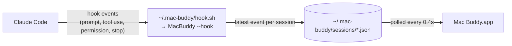

<div align="center">


# Mac Buddy

**A tiny desktop companion that lives on your Mac's screen and reacts while [Claude Code](https://claude.com/claude-code) works.**

It types on its laptop while Claude is busy, waves when Claude needs your permission, celebrates when the task is done, and naps when nothing's going on.

**This version also works with Cursor**, and turns blue when Cursor is the one working.

[](#install)
[](https://swift.org)
[](#install)
[](LICENSE)
[](#contributing)

[Install](#install) · [Features](#features) · [Customize](#customize) · [How it works](#how-it-works) · [FAQ](#faq)

</div>

---

> Based on [Mac Buddy by Mohsin Ajmal](https://github.com/mohsin2596/mac-buddy) (MIT licensed), with Cursor support added.

## What's added in this version

- 🎙️ **Talk to your buddy, powered by Gemini.** Double-click it or press <kbd>Control</kbd>+<kbd>Option</kbd>+<kbd>B</kbd> and just speak. Simple things happen instantly (*"open Safari"*, *"play Atif Aslam"*, *"volume up"*, *"set a timer for 5 minutes"*). Everything else goes to **Gemini** using your Google account (Google AI Pro), which answers out loud and can do things on your Mac: *"make a note called shopping with milk and eggs"*, *"remind me tomorrow at 9 to call Ali"*, *"turn on dark mode"*, *"make a folder on my Desktop called Projects"*. Follow-up questions remember the conversation.

- 🗣️ **English, Urdu and Punjabi.** Talk in any of them, or mix them. The buddy replies in the language you used, shows Urdu/Punjabi in Roman letters in its bubble, and speaks it with the Hindi voice (macOS has no Urdu voice). Simple commands work in Roman Urdu too: *"YouTube kholo"*, *"Kesariya chalao"*, *"awaz barhao"*, *"kitne baje hain"*. Choose in **Settings → Behavior → Voice assistant → Language**.
- 🤝 **A personal companion that talks first.** The buddy greets you by name, chats about what you're doing (*"Ooh, cricket! Who do you think will win, Umar?"*, *"That's a sad one. Everything okay?"*), reminds you to stretch after an hour of work, and tells you to sleep when it's very late. Gemini writes each line fresh. When it asks you something, it listens for your answer, and every answer keeps the conversation going until you stop replying or say "thanks" or "bye". It stays silent during Quran recitation and calls. Set how chatty it is in **Settings → Behavior → Personal companion**.
- ✨ **Modern AI look.** While you talk to it, a colorful glowing aura pulses with your voice and a live voice wave moves in a frosted-glass bubble. While Gemini thinks, the aura swirls and glowing particles orbit its head. When it answers, its mouth moves with each word and the answer types out in the bubble as it speaks. Optional in **Settings → Appearance → Look**: an **AI look** (shimmering purple-blue body with a glowing orb antenna) and **digital eyes** (glowing LED eyes on a dark screen).
- 🖱️ **Cursor support.** The buddy reacts to Cursor's AI agent as well as Claude Code.
- 🔵 **Cursor looks different.** While Cursor's agent works, or whenever Cursor is the app you're using, the buddy turns blue, puts on headphones and shows a `</>` symbol on its laptop. With Claude it keeps its usual orange look.
- 🎵 **Reacts to your music.** Play something in Music, Spotify, or on YouTube in Safari, Chrome, Brave or Edge and the buddy reads the title: it **dances** to party and wedding songs, **gets sad** (with a little tear) at sad songs, **blushes with floating hearts** for romantic songs, **nods along** to everything else, and for **Quran recitation** it goes still, closes its eyes and listens quietly. It only reads titles and never records audio. Turn it off from the right-click menu (**React to Music, Sports & Work**).
- 🏏 **Watches sports with you.** Open cricket (PSL, IPL, a match on YouTube, Cricinfo or Cricbuzz), football, basketball, tennis, hockey, F1 or boxing/UFC and the buddy watches excitedly with the sport's ball bouncing beside it, jumping up to cheer every few seconds.
- 💻 **Works along with you.** When the tab in front is a work site (Google Docs/Sheets, Gmail, GitHub, Notion, Figma, Jira, Upwork, Fiverr, Canva, Slack…) or a work app like VS Code, Xcode, Excel or Terminal is in front, the buddy types on its laptop: *"Working · Google Docs"*.
- 🌐 **Reacts to every website you open.** It scrolls along on LinkedIn, Facebook, Instagram or X (with 👍 and ❤️ popping up), chats on WhatsApp Web, hops around while you shop on Daraz or Amazon, reads the news on Dawn or BBC, studies on Wikipedia or Udemy, thinks hard during a Google search, gets hungry on foodpanda, eats popcorn on Netflix, plans trips on Booking or Google Maps, makes a serious money face on JazzCash or your bank, mashes buttons on game sites, and looks around curiously everywhere else.
- 🏷️ **The bubble says who's working**: *"Claude · my-app"* or *"Cursor · my-app"*, and *"Claude is done!"* or *"Cursor is done!"* when it finishes.

## Features

<p align="center">
  
</p>

- 🧑‍💻 **Knows what Claude is doing.** A speech bubble shows the current step, like *"my-app · Running tests"* or *"Editing App.swift"*, plus a `×2` badge when several sessions are busy at once.
- ☕️ **Has a little routine while working.** It mostly types, but takes breaks to sip coffee, read, think and juggle.
- 🙋 **Gets your attention.** When Claude is waiting on a permission prompt, it waves and shows a red bubble.
- 🎉 **Celebrates** when Claude finishes a task.
- 😴 **Falls asleep** when nothing's happening, and wakes up when you click it.
- 👆 **Reacts to clicks** with a spin, backflip, boing, wave or giggle, and gets dizzy if you click it too much. You can also write your own lines for it to say.
- 👀 **Eyes follow your cursor** anywhere on screen (optional).
- 🪟 **Stays out of your way.** It floats above your windows on every Space, clicks next to it go straight through to whatever is underneath, and clicking it never takes focus away from your terminal.
- 🎨 **Highly customizable.** Size, colors, accessories, shape, behavior and more, all applied live.
- 🪶 **Lightweight.** A single native Swift app with no Electron, no web views and no dependencies.

<p align="center">
  
</p>

## Install

**Requirements:** macOS 14 Sonoma or later (Apple silicon or Intel) and [Claude Code](https://claude.com/claude-code). Nothing else.

### Option 1: Download the app

<a href="https://github.com/mohsin2596/mac-buddy/releases/latest/download/MacBuddy.dmg"></a>

1. Open `MacBuddy.dmg` and drag **Mac Buddy** into **Applications**.
2. Open Mac Buddy from Applications.
3. Click **Connect** when it asks to connect to Claude Code, then restart any open Claude Code sessions.

> [!IMPORTANT]
> Mac Buddy isn't notarized by Apple yet, so the first time you open it macOS says it *"could not verify"* the app. Click **Done**, then go to **System Settings → Privacy & Security**, scroll down and click **Open Anyway**. You only have to do this once.

### Option 2: One-line install (no security prompt)

```bash
curl -fsSL https://raw.githubusercontent.com/mohsin2596/mac-buddy/main/scripts/get.sh | sh
```

This downloads the latest release into `/Applications`, connects it to Claude Code and launches it. Files downloaded from Terminal aren't flagged by Gatekeeper, so there's no "Open Anyway" step. [Read the script](scripts/get.sh) first if you like.

### Option 3: Build from source (includes Cursor support and the voice assistant)

Options 1 and 2 install the original release without Cursor support. To get this version, build from source. It needs the Xcode Command Line Tools (`xcode-select --install`).

```bash
git clone https://github.com/UmarIT/mac-buddy-.git
cd mac-buddy-
./install.sh
```

The installer also connects Cursor if it's installed. To connect Cursor later, run `python3 cursor/mac-buddy-cursor.py install` and restart Cursor.

#### Set up the voice assistant (Gemini)

The buddy's brain is Google's **Antigravity CLI** (`agy`), the successor to Gemini CLI, signed in with your Google account so it uses your Gemini plan.

```bash
curl -fsSL https://antigravity.google/cli/install.sh | bash
agy        # opens your browser once to sign in with Google, then type /exit
```

**Make it fast (recommended):** get a free Gemini API key at [aistudio.google.com/apikey](https://aistudio.google.com/apikey) and paste it in **Settings → Behavior → Voice assistant → Gemini API key**. Chatting then goes straight to Gemini and answers in about a second; only requests to *do* something on your Mac use the slower Antigravity agent. The key is stored in your macOS Keychain.

Then double-click the buddy and speak. The first time, click **Allow** for **Microphone** and **Speech Recognition** (and for any app Gemini controls, such as Notes or Reminders).

> [!WARNING]
> With **Let Gemini do things on my Mac** on (the default), Gemini runs commands without asking first. It's told never to delete files, send messages, post, buy anything or change security settings unless you clearly ask for exactly that, but speech can be misheard. Turn it off in **Settings → Behavior** if you only want answers.

### What "Connect" does

It adds a few hooks to `~/.claude/settings.json` that forward Claude Code's events to Mac Buddy. Your existing settings and hooks are kept, and a backup is saved as `settings.json.bak-macbuddy`. You can connect or disconnect at any time from the right-click menu or **Settings → Claude Code**.

### Update

Download the new DMG and replace the app, or re-run the one-line installer.

### Uninstall

Right-click the buddy, choose **Disconnect from Claude Code**, then quit it and drag Mac Buddy to the Trash. Or, from a clone of this repo:

```bash
./uninstall.sh
```

## Usage

| Action | What happens |
| --- | --- |
| **Click** the buddy | It reacts and says something |
| **Double-click** the buddy, or press <kbd>⌃</kbd><kbd>⌥</kbd><kbd>B</kbd> | Starts listening. Speak, then pause; it answers out loud. Press again while it's listening to send right away, or while it's thinking to cancel |
| **Drag** the buddy | Moves it; the position is remembered |
| **Right-click** the buddy | Say Hi, Eyes Follow Cursor, Settings…, Reset Position, Quit |
| **Open the app again** (Spotlight / Finder) | Opens the Settings window |

## Customize

Open **Settings…** from the right-click menu. A live preview on the left shows every change instantly; you can hover over it to test eye tracking, click it to test reactions, and switch between states.

<p align="center">
  
</p>

<table>
<tr><th>Appearance</th><th>Behavior</th><th>Claude Code</th></tr>
<tr valign="top">
<td>

- Size (50%–300%)
- Opacity
- 9 color presets: Claude, Mint, Sky, Grape, Bubblegum, Lemon, Forest, Snow, Midnight
- Custom body and limb colors
- Accessories: party hat, top hat, crown, bow, flower, headphones, glasses
- Roundness and pupil size
- Antenna and rosy cheeks on/off

</td>
<td>

- Eyes follow your cursor
- Animation speed (0.25×–2×)
- Click reactions on/off
- Your own click phrases
- Fall asleep after *N* minutes
- Stay on top of other windows
- Show on every desktop (Space)
- Open at login

</td>
<td>

- Show a bubble while Claude works
- Show the project name
- Celebrate when Claude finishes
- Only show the buddy while Claude is active
- Follow only projects whose path matches a filter
- Check whether the hooks are installed

</td>
</tr>
</table>

## How it works



1. Claude Code runs [hooks](https://docs.claude.com/en/docs/claude-code/hooks) on `UserPromptSubmit`, `PreToolUse`, `PostToolUse`, `PermissionRequest`, `Stop`, `SessionStart` and `SessionEnd`.
2. A tiny shim script hands each event to the Mac Buddy binary itself (`MacBuddy --hook`), which boils it down to a small JSON file per session: the event, the tool, the target file or command, and the project folder. It takes a few milliseconds, prints nothing and never blocks Claude.
3. The app reads those files and works out a single mood:

   **needs you** › **working** › **just finished** › **asleep** › **idle**

Everything stays on your Mac. No network calls, no telemetry.

### Project layout

```
Sources/
  App.swift             App delegate, floating window, menus, cursor tracking
  Character.swift       The character, speech bubble and accessories (pure SwiftUI drawing)
  WorkActivities.swift  What it does while Claude works (typing, coffee, juggling…)
  Model.swift           Reads hook state, decides the mood, click reactions
  Settings.swift        Persisted settings, colours, accessories
  SettingsView.swift    The Settings window
  ClaudeHooks.swift     Hook handling plus connecting/disconnecting Claude Code
  NowPlaying.swift      Reads what you're playing, watching or working on and picks a reaction
  Listener.swift        Microphone + speech-to-text (on-device when supported)
  Commands.swift        Instant built-in commands (open apps/sites, play songs, volume, timers…)
  FastGemini.swift      Fast chat straight to the Gemini API (with your free key, kept in the Keychain)
  Gemini.swift          Requests that need action go to the Antigravity agent (agy -p)
  VoiceBuddy.swift      Listen → do it → answer out loud → listen for your reply
  Companion.swift       Talks by itself: greetings, comments, break and bedtime reminders
  Language.swift        English / Urdu / Punjabi: recognizer choice, reply format, Roman Urdu commands
  Speech.swift          Text-to-speech
  HotKey.swift          The global Control-Option-B shortcut
  AIEffects.swift       Aura, thinking particles, live voice wave and mic level
cursor/mac-buddy-cursor.py  Connects Cursor's agent to the buddy (adds hooks to ~/.cursor/hooks.json)
scripts/make-release.sh   Builds MacBuddy.dmg + MacBuddy.zip for a GitHub release
scripts/get.sh            The one-line installer
Tools/RenderAssets.swift  Renders the README images from the real drawing code
```

### Build from source

```bash
./build.sh            # → build/MacBuddy.app (universal, ad-hoc signed)
open build/MacBuddy.app
```

No Xcode project is needed; it's plain `swiftc`. To package a release, run `scripts/make-release.sh 1.2.0` and upload `dist/MacBuddy.dmg` and `dist/MacBuddy.zip` to a GitHub release with those exact names.

To regenerate the images in `docs/` after changing how the buddy looks:

```bash
scripts/render-assets.sh
```

## FAQ

<details>
<summary><b>The buddy says "working" but Claude is done.</b></summary>

Claude Code doesn't send a `Stop` event when you interrupt a turn with <kbd>Esc</kbd>. The buddy treats "working" as stale after 5 minutes without activity (15 minutes while a tool is running), so it will settle down on its own.
</details>

<details>
<summary><b>It follows a session I don't care about.</b></summary>

In **Settings → Claude Code → Sessions**, enter part of a folder path (e.g. `my-app`) to follow only matching projects.
</details>

<details>
<summary><b>The buddy doesn't react to Claude at all.</b></summary>

- Check **Settings → Claude Code → Connection**. It should say *Connected*. If not, click **Connect to Claude Code**.
- Restart any Claude Code sessions that were started before installing.
</details>

<details>
<summary><b>macOS says it "could not verify" Mac Buddy.</b></summary>

The app isn't notarized yet. Go to **System Settings → Privacy & Security** and click **Open Anyway** (once). Or remove the download flag in Terminal: `xattr -dr com.apple.quarantine /Applications/MacBuddy.app`. The [one-line installer](#option-2-one-line-install-no-security-prompt) avoids this entirely.
</details>

<details>
<summary><b>Does it work with other tools besides Claude Code?</b></summary>

Yes, Cursor works too (see Option 3). Beyond that, anything that writes a JSON file like `{"event": "PreToolUse", "tool": "Bash", "cwd": "/path"}` into `~/.mac-buddy/sessions/` will drive the buddy, so it's easy to hook up to other agents or scripts.
</details>

<details>
<summary><b>The buddy says it can't hear me, even though I clicked Allow.</b></summary>

Apps built from source are signed ad hoc, so after a rebuild macOS can keep an old "blocked" setting and silently refuse. Reset the permissions and open the app again:

```bash
tccutil reset Microphone io.github.mohsin2596.macbuddy
tccutil reset SpeechRecognition io.github.mohsin2596.macbuddy
killall MacBuddy; open ~/Applications/MacBuddy.app
```

Then double-click the buddy and click **Allow** for both. You may need to do this again after updating.
</details>

## Contributing

Contributions are very welcome, whether that's new accessories, animations, reactions, or bug fixes.

1. Fork the repo and create a branch.
2. Make your change, run `./build.sh` and try it out.
3. If you changed how the buddy looks, run `scripts/render-assets.sh` to refresh the images.
4. Open a pull request with a short description (a GIF is always appreciated 🙂).

Ideas: more accessories, seasonal outfits, sounds, a menu bar icon, multiple buddies (one per session), walking along the Dock.

## License

[MIT](LICENSE) © Mohsin Ajmal

<sub>Mac Buddy is a fan project and is not affiliated with Anthropic.</sub>
